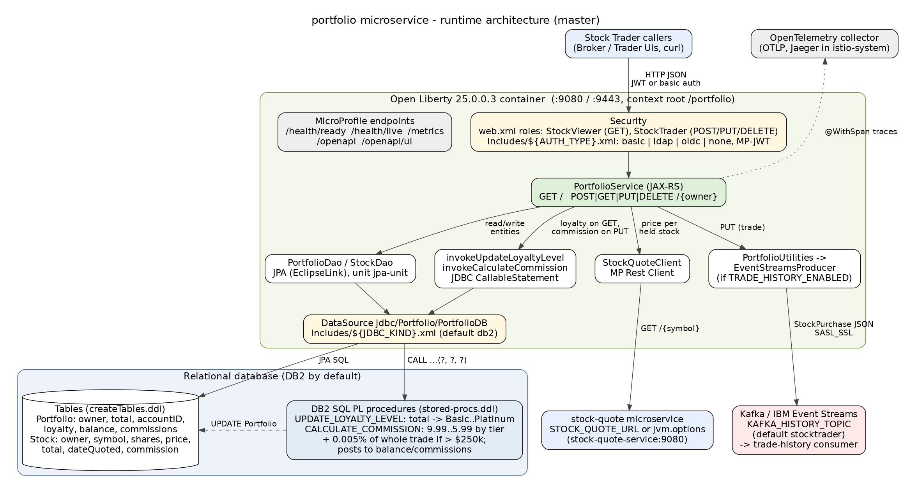

<!--
       Copyright 2017-2021 IBM Corp All Rights Reserved
       Copyright 2022-2023 Kyndryl Corp, All Rights Reserved

   Licensed under the Apache License, Version 2.0 (the "License");
   you may not use this file except in compliance with the License.
   You may obtain a copy of the License at

       http://www.apache.org/licenses/LICENSE-2.0

   Unless required by applicable law or agreed to in writing, software
   distributed under the License is distributed on an "AS IS" BASIS,
   WITHOUT WARRANTIES OR CONDITIONS OF ANY KIND, either express or implied.
   See the License for the specific language governing permissions and
   limitations under the License.
-->


This microservice manages a *stock portfolio* for the IBM Stock Trader sample. It is a Jakarta EE 10 /
MicroProfile 6.1 app on **Open Liberty**, backed by a relational database (**DB2** by default) that holds two
tables, `Portfolio` and `Stock`. Rows are read and written through *JPA* over the `jdbc/Portfolio/PortfolioDB`
data source, and the loyalty-level and commission rules live in two **DB2 stored procedures**
(`UPDATE_LOYALTY_LEVEL` and `CALCULATE_COMMISSION`, in [stored-procs.ddl](stored-procs.ddl)) that the service
calls over *JDBC*. Stock prices come from the *stock-quote* microservice, and trades can optionally be published
to *Kafka* for trade history.

See **[docs/architecture.md](docs/architecture.md)** for the full architecture: components, database contract,
request flow, security, configuration and deployment.



The diagram is generated from the editable Graphviz source [docs/diagrams/architecture.dot](docs/diagrams/architecture.dot)
(also rendered as [SVG](docs/diagrams/architecture.svg)); run `docs/diagrams/render.sh` after editing it.

The following operations are available (all under `/portfolio`):

`GET /` - gets summary data for one page of portfolios (`page`, `pageSize` query params; deprecated).

`POST /{owner}` - creates a new portfolio for the specified owner (optional `accountID` query param), with
loyalty *Basic*, a balance of 50.0 and no commissions.

`GET /{owner}` - gets details for the specified owner, refreshing every stock price and the loyalty level
(`immutable=true` returns the stored values without stocks or refresh).

`PUT /{owner}` - buys (or, with negative *shares*, sells) a stock for the specified owner; query params *symbol*,
*shares* and an optional fallback *commission*.

`DELETE /{owner}` - removes the portfolio (and its stocks) for the specified owner.

All operations return *JSON*. A *portfolio* object contains fields named *owner*, *total*, *accountID*,
*loyalty*, *balance*, *commissions* and *lastTrade*, plus a *stocks* object keyed by symbol. A *stock* object
contains fields named *symbol*, *shares*, *commission*, *price*, *total*, and *date*.

For example, doing a `PUT http://localhost:9080/portfolio/John?symbol=IBM&shares=123` against a freshly created
portfolio for *John* (with IBM quoted at 155.45) calls `CALCULATE_COMMISSION('John', 19120.35, ?)`, which
charges the *Basic* commission of 9.99 to the portfolio's balance and commissions, inserts the `Stock` row
through JPA, re-quotes every held stock and calls `UPDATE_LOYALTY_LEVEL('John', 19120.35, ?)`, which moves John
to *Bronze*. A following `GET http://localhost:9080/portfolio/John` returns:

```json
{"accountID":"acct-1","balance":40.01,"commissions":9.99,"lastTrade":0.0,"loyalty":"Bronze","owner":"John",
 "stocks":{"IBM":{"symbol":"IBM","shares":123,"commission":9.99,"price":155.45,"total":19120.35,"date":"2026-11-20"}},
 "total":19120.35}
```

Commissions are tiered by loyalty (Basic 9.99, Bronze 8.99, Silver 7.99, Gold 6.99, Platinum 5.99); a trade worth
more than $250,000 also pays 0.005% of its whole value; loyalty levels start at 10,000 (Bronze), 50,000 (Silver), 100,000 (Gold) and
1,000,000 (Platinum).

To set up the database, run [createTables.ddl](createTables.ddl) and then, on DB2,
`db2 -td@ -f stored-procs.ddl`. The `JDBC_KIND` env var picks the Liberty data source include
(`db2` by default; `postgres`, `sqlserver`, `oracle`, `mysql`, `derby` and `none` also exist under
*src/main/liberty/config/includes*), and `JDBC_HOST`, `JDBC_PORT`, `JDBC_DB`, `JDBC_ID` and `JDBC_PASSWORD`
supply the connection (from the `db2` *Kubernetes* secret in the manifests). The stored procedures are DB2 SQL
PL, so on other databases the loyalty level is not updated and the commission falls back to the `commission`
query param of the `PUT`. The database can be another pod in the same *Kubernetes* environment, on-premises,
or a database-as-a-service. See *manifests/deploy.yaml* and the Helm chart in *chart/portfolio* for the
environment variables the service expects.

### Prerequisites for ICP Deployment (legacy)
 This project requires two secrets: `jwt` and `db2`.  You can get the DB2 values from inspecting your DB2 secrets.
  ```bash
  kubectl create secret generic jwt -n stock-trader --from-literal=audience=stock-trader --from-literal=issuer=http://stock-trader.ibm.com
  
  kubectl create secret generic db2 --from-literal=id=<DB2_USERNAME> --from-literal=pwd=<DB2_PASSWORD> --from-literal=host=<DB2_SVC_NAME> --from-literal=port=50000 --from-literal=db=<TRADER_DB_NAME>
  
  # Example db2:
  kubectl create secret generic db2 --from-literal=id=db2inst1 --from-literal=pwd=db2inst1 --from-literal=host=trader-ibm-db2oltp-dev --from-literal=port=50000 --from-literal=db=trader
  ```
  
  You'll also need to enable login to the IBM Cloud Private internal Docker registry by following [these steps]
  (https://www.ibm.com/support/knowledgecenter/en/SSBS6K_2.1.0/manage_images/configuring_docker_cli.html).  Don't 
  forget to restart Docker after adding your cert.  On macOS you can restart Docker by running:
  ```bash
  osascript -e 'quit app "Docker"'
  open -a Docker
  ```
 
 ### Build and Deploy to ICP
To build `portfolio` clone this repo and run:
```bash
mvn package
docker build -t portfolio:latest -t <ICP_CLUSTER>.icp:8500/stock-trader/portfolio:latest .
docker tag portfolio:latest <ICP_CLUSTER>.icp:8500/stock-trader/portfolio:latest
docker push <ICP_CLUSTER>.icp:8500/stock-trader/portfolio:latest
```

Use the *Open Liberty* helm chart to deploy the *Portfolio* microservice to ICP:
```bash
helm repo add ibm-charts https://raw.githubusercontent.com/IBM/charts/master/repo/stable/
helm install ibm-charts/ibm-websphere-liberty -f <VALUES_YAML> -n <RELEASE_NAME> --tls
```

In practice this means you'll run something like:
```bash
docker build -t portfolio:latest -t mycluster.icp:8500/stock-trader/portfolio:latest .
docker tag portfolio:latest mycluster.icp:8500/stock-trader/portfolio:latest
docker push mycluster.icp:8500/stock-trader/portfolio:latest

helm repo add ibm-charts https://raw.githubusercontent.com/IBM/charts/master/repo/stable/
helm install ibm-charts/ibm-websphere-liberty -f manifests/portfolio-values.yaml -n portfolio --namespace stock-trader --tls
```

Note that nowadays, we tend to use the operator, in the sibling *stocktrader-operator* repository, to deploy
the entire Stock Trader application as a whole (to AKS, EKS, GCP, IKS, OCP, or TKG), instead of deploying the
microservices one by one.  See the readme in the operator repo for more details.


