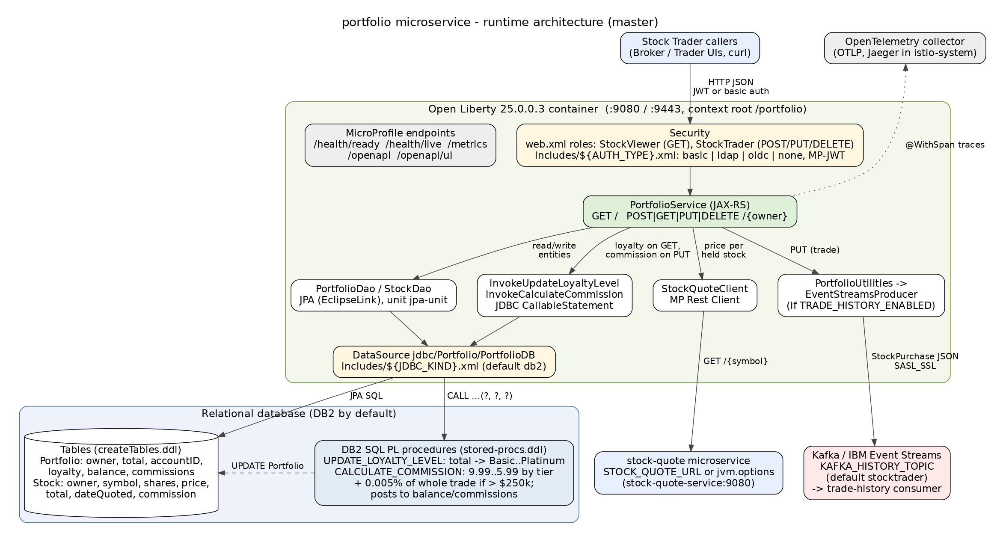

# Portfolio microservice architecture

This page describes the `portfolio` microservice as it is on `master` of
[COG-GTM/ibm-portfolio](https://github.com/COG-GTM/ibm-portfolio) (a fork of
[IBMStockTrader/portfolio](https://github.com/IBMStockTrader/portfolio)). It covers the runtime
components, the database contract (tables plus DB2 stored procedures), the outbound calls and how
the service is built and deployed.

The diagram source is [`diagrams/architecture.dot`](diagrams/architecture.dot) (Graphviz). Edit it and
run [`diagrams/render.sh`](diagrams/render.sh) to regenerate
[`architecture.png`](diagrams/architecture.png) and [`architecture.svg`](diagrams/architecture.svg).

## Runtime

| Component | Where | What it does |
|---|---|---|
| Open Liberty 25.0.0.3 (Java 17, OpenJ9) | `Dockerfile`, `src/main/liberty/config/server.xml` | Hosts `Portfolio.war` at context root `/portfolio` on ports 9080 (HTTP) and 9443 (HTTPS). Features: `restfulWS-3.1`, `microProfile-6.1`, `persistence-3.1`, `jdbc-4.3`, `jndi-1.0`, `appSecurity-5.0`. |
| `PortfolioService` | `src/main/java/.../portfolio/PortfolioService.java` | The JAX-RS resource. Every operation is `@Transactional` (JTA). |
| `PortfolioDao`, `StockDao` | `.../portfolio/dao/` | JPA (EclipseLink) access to the `Portfolio` and `Stock` tables through persistence unit `jpa-unit` (`src/main/resources/META-INF/persistence.xml`). Shared cache is off so the service can scale past one pod. |
| Stored procedure calls | `PortfolioService.invokeUpdateLoyaltyLevel` / `invokeCalculateCommission` | Plain JDBC `CallableStatement`s on the same data source (`jdbc/Portfolio/PortfolioDB`) that call the DB2 procedures below. |
| `StockQuoteClient` | `.../portfolio/client/StockQuoteClient.java` | MicroProfile Rest Client for the `stock-quote` microservice. URL from the `STOCK_QUOTE_URL` env var, else `jvm.options` (`http://stock-quote-service:9080/stock-quote`). The `Authorization` header is propagated (`microprofile-config.properties`). |
| `PortfolioUtilities` / `EventStreamsProducer` | `.../portfolio/` | When `TRADE_HISTORY_ENABLED=true` and `KAFKA_ADDRESS` is set, each trade is published as a `StockPurchase` JSON message to `KAFKA_HISTORY_TOPIC` (default `stocktrader`) over SASL_SSL (`KAFKA_USER`, `KAFKA_API_KEY`). |
| Health | `.../portfolio/health/` | MicroProfile Health: `/health/ready` is up only when the `JWT_AUDIENCE` and `JWT_ISSUER` env vars are set (even with `AUTH_TYPE=none`); `/health/live` goes down once the static `PortfolioService.consecutiveErrors` counter reaches 3; the operations bump it on most internal failures (not on a 404 for a missing owner) and reset it on success. |
| Metrics, OpenAPI, tracing | `server.xml`, `microprofile-config.properties` | `/metrics` (unauthenticated), `/openapi` and `/openapi/ui`, OpenTelemetry spans (`@WithSpan`) exported over OTLP to a Jaeger collector. |

### Security

`web.xml` gives `GET` to the `StockViewer` and `StockTrader` roles and `POST`/`PUT`/`DELETE` to
`StockTrader` only. `server.xml` includes `includes/${AUTH_TYPE}.xml`:

- `basic` (the default, despite the name): MP-JWT only. Callers send a JWT signed with the
  `jwtSigner` key, issuer `JWT_ISSUER` (default `http://stock-trader.ibm.com`) and audience
  `JWT_AUDIENCE` (default `stock-trader`); the `basicRegistry` in this file is commented out.
- `none`: no JWT check; a demo `basicRegistry` and HTTP basic auth instead (for example
  `curl -u stock:trader`, group `StockTrader`; `read:only` is a `StockViewer`). Meant for dev/test.
- `ldap` and `oidc`: external registries.

The SSO cookie is `StockTraderSSO`. `KAFKA_ADDRESS` must be set to a non-empty value even when trade history
is off: the service fails to start when it is empty or unset.

### Database selection

`server.xml` includes `includes/${JDBC_KIND}.xml`. `JDBC_KIND` defaults to `db2`; `postgres`,
`sqlserver`, `oracle`, `mysql`, `derby` and `none` also exist. Connection details come from the
`JDBC_HOST`, `JDBC_PORT`, `JDBC_DB`, `JDBC_ID` and `JDBC_PASSWORD` env vars (set from the `db2`
Kubernetes secret in the manifests). `mvn package` copies every driver jar into `target/prereqs`,
which the `Dockerfile` copies to `/config/prereqs`.

## Database contract

Run [`createTables.ddl`](../createTables.ddl) and then, on DB2,
[`stored-procs.ddl`](../stored-procs.ddl) (`db2 -td@ -f stored-procs.ddl`).

**Tables**

- `Portfolio(owner PK, total, accountID, loyalty, balance, commissions)`
- `Stock(owner FK -> Portfolio ON DELETE CASCADE, symbol, shares, price, total, dateQuoted, commission)`, primary key `(owner, symbol)`

**Stored procedures** (DB2 SQL PL; they own the loyalty and commission rules)

| Procedure | Called from | Rule |
|---|---|---|
| `UPDATE_LOYALTY_LEVEL(owner, total, OUT loyalty)` | `GET /{owner}` (and so every `PUT`) after the stock prices are refreshed | `Platinum` >= 1,000,000; `Gold` >= 100,000; `Silver` >= 50,000; `Bronze` >= 10,000; else `Basic`. Writes `Portfolio.loyalty`. |
| `CALCULATE_COMMISSION(owner, tradeValue, OUT commission)` | `PUT /{owner}` before the stock row is written | Platinum 5.99, Gold 6.99, Silver 7.99, Bronze 8.99, Basic 9.99. A trade worth more than $250,000 also pays 0.005% of its whole value (e.g. +15.00 on $300,000). Adds the commission to `Portfolio.commissions` and subtracts it from `Portfolio.balance`. |

If a procedure call fails (for example on a database where `stored-procs.ddl` was not run), the
service logs a warning and carries on: the loyalty level is left unchanged and the commission falls
back to the `commission` query parameter of the `PUT` (0 when omitted).

## REST API

All paths are relative to `/portfolio`; responses are JSON.

| Operation | Parameters | Behaviour |
|---|---|---|
| `GET /` | `page` (default 1), `pageSize` (default 10) | One page of portfolios ordered by owner, without stocks. Marked `@Deprecated`; an `owners` param is declared but ignored. |
| `POST /{owner}` | `accountID` (optional) | Creates a portfolio with loyalty `Basic`, balance 50.0 and commissions 0. The code throws 409 for an existing owner and 400 for owner `FAIL`, but catches both itself: callers get 200 with an unsaved `Basic` portfolio, or 204 for `FAIL`. |
| `GET /{owner}` | `immutable` (optional) | Reads the portfolio and its stocks, refreshes each stock's price from `stock-quote`, recomputes the total, calls `UPDATE_LOYALTY_LEVEL` and saves. With `immutable=true` it returns the stored row without stocks or refresh. 404 if absent. |
| `PUT /{owner}` | `symbol`, `shares` (negative to sell), `commission` (fallback) | Gets a quote, calls `CALCULATE_COMMISSION` on `shares x price`, inserts or updates (or, at 0 shares, deletes) the `Stock` row, then runs the `GET` refresh. Publishes to Kafka when enabled. The `balance` and `commissions` in the `PUT` response are the values from before the procedure ran; the next `GET` shows the charged values. |
| `DELETE /{owner}` | | Deletes the portfolio (its stocks cascade). |

A portfolio is returned as `owner`, `total`, `accountID`, `loyalty`, `balance`, `commissions`,
`lastTrade`, `operation` and `stocks` (an object keyed by symbol, each with `symbol`, `shares`,
`commission`, `price`, `total` and `date`). The generated spec is in
[`src/main/generated/openapi/`](../src/main/generated/openapi/).

### Trade sequence (`PUT /portfolio/{owner}?symbol=IBM&shares=123`)

1. Load the `Portfolio` row (404 if absent).
2. `stock-quote GET /IBM` gives the trade value (`123 x price`).
3. `CALL CALCULATE_COMMISSION(owner, tradeValue, ?)` posts the fee to `balance` / `commissions`.
4. Insert or update the `Stock` row through JPA.
5. Refresh: re-quote every held stock, update each `Stock` row, recompute `total`,
   `CALL UPDATE_LOYALTY_LEVEL(owner, total, ?)`, merge the `Portfolio` row.
6. If `CASH_ACCOUNT_ENABLED`, set `lastTrade`; if `TRADE_HISTORY_ENABLED`, publish to Kafka.

## Build, CI and deployment

| Item | Where |
|---|---|
| Build | `mvn package` (Java 17) produces `target/portfolio-1.0-SNAPSHOT.war`, the JDBC drivers in `target/prereqs` and regenerates the OpenAPI files (SmallRye plugin). |
| Image | `Dockerfile` on `openliberty/open-liberty:25.0.0.3-full-java17-openj9-ubi`. |
| Tests | `src/test/.../HealthEndpointIT.java` is the only test; no failsafe/Liberty plugin runs it in the Maven build. |
| CI | `.github/workflows/`: SonarCloud analysis on push/PR, and build/scan/push workflows for Azure ACR and AWS ECR that update a GitOps repo (see [`.github/workflows/README.md`](../.github/workflows/README.md)). |
| Kubernetes | `manifests/deploy.yaml` (probes on `/health/ready` and `/health/live`), `manifests/deploy-openshift.yaml`, the Helm chart in `chart/portfolio/`, and the older `manifests/portfolio-values.yaml`. The whole Stock Trader app is usually deployed by the sibling `stocktrader-operator` repo. |
