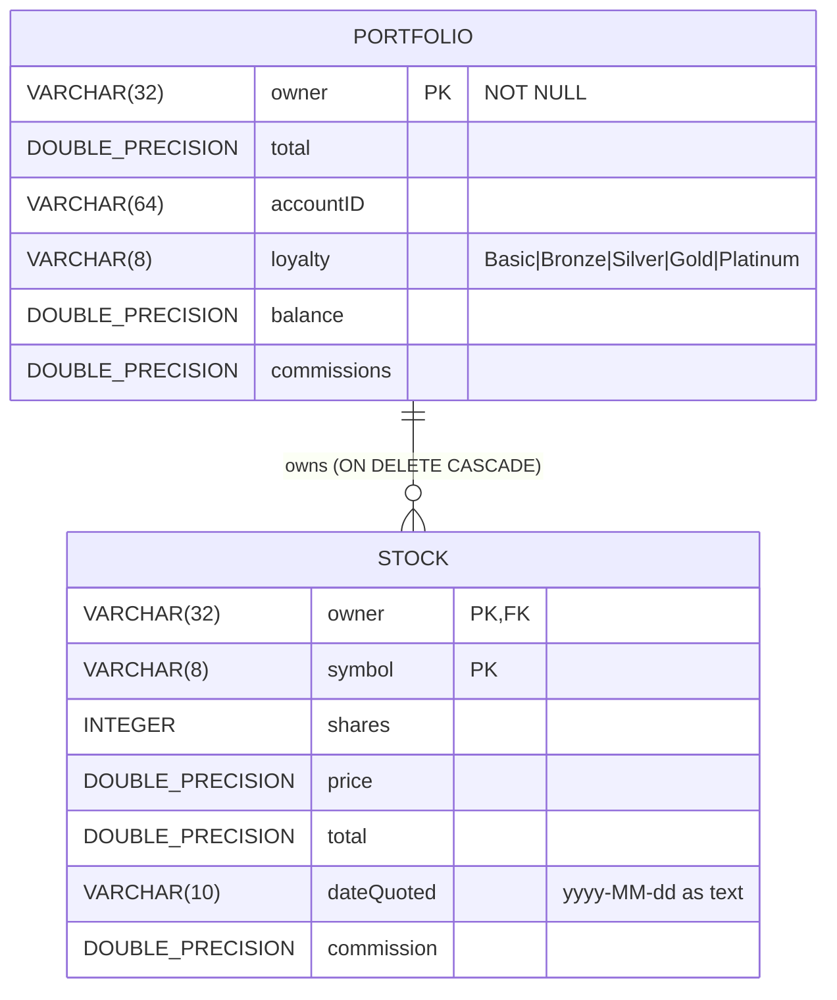

# DB2 Footprint Assessment — `portfolio` microservice

Scope: everything in this repository that touches IBM DB2, as the starting point for the
DB2 → PostgreSQL OLTP migration.

## 1. Inventory at a glance

| Artifact | Path | DB2 dependency |
| --- | --- | --- |
| Schema DDL | `createTables.ddl` | `db2 -tf` script, `DOUBLE PRECISION` columns, no schema qualifier |
| Stored procedures | `stored-procs.ddl` | DB2 SQL PL (`LANGUAGE SQL`, `SPECIFIC`, `DOUBLE`, `@` statement terminator) |
| Liberty datasource | `src/main/liberty/config/includes/db2.xml` | `properties.db2.jcc`, `jcc-12.1.0.0.jar`, `securityMechanism="3"` |
| Datasource switch | `src/main/liberty/config/server.xml` | `JDBC_KIND` variable (`defaultValue="db2"`) selects the include |
| JDBC driver dep | `pom.xml` | `com.ibm.db2:jcc:12.1.0.0` (provided) |
| Proc call sites | `PortfolioService.invokeUpdateLoyaltyLevel`, `PortfolioService.invokeCalculateCommission` | `CallableStatement` `CALL UPDATE_LOYALTY_LEVEL(?,?,?)` / `CALL CALCULATE_COMMISSION(?,?,?)` |
| ORM access | `dao/PortfolioDao.java`, `dao/StockDao.java`, JPA entities `json/Portfolio.java`, `json/Stock.java` | JPA/EclipseLink — portable, dialect auto-detected |
| Deployment | `chart/portfolio/*`, `manifests/*`, `README.md` | `db2` secret (`id`, `pwd`, `host`, `port`, `db`) → `JDBC_*` env vars |

## 2. Schema

### 2.1 `Portfolio`

| Column | DB2 type | Nullability | Notes |
| --- | --- | --- | --- |
| `owner` | `VARCHAR(32)` | `NOT NULL` | PK, natural key (no identity column anywhere in the schema) |
| `total` | `DOUBLE PRECISION` | nullable | Current market value of all holdings, recomputed on every read |
| `accountID` | `VARCHAR(64)` | nullable | Foreign reference to the (external) Account microservice |
| `loyalty` | `VARCHAR(8)` | nullable | `Basic`/`Bronze`/`Silver`/`Gold`/`Platinum` — written by `UPDATE_LOYALTY_LEVEL` |
| `balance` | `DOUBLE PRECISION` | nullable | Cash balance, debited by `CALCULATE_COMMISSION` |
| `commissions` | `DOUBLE PRECISION` | nullable | Running total of commissions, credited by `CALCULATE_COMMISSION` |

### 2.2 `Stock`

| Column | DB2 type | Nullability | Notes |
| --- | --- | --- | --- |
| `owner` | `VARCHAR(32)` | `NOT NULL` | PK part 1, FK → `Portfolio(owner)` `ON DELETE CASCADE` |
| `symbol` | `VARCHAR(8)` | `NOT NULL` | PK part 2 |
| `shares` | `INTEGER` | nullable | Rows are deleted when shares reach 0 |
| `price` | `DOUBLE PRECISION` | nullable | Last quote from the `stock-quote` microservice |
| `total` | `DOUBLE PRECISION` | nullable | `shares * price` |
| `dateQuoted` | `VARCHAR(10)` | nullable | `yyyy-MM-dd` **stored as text**, not a `DATE` |
| `commission` | `DOUBLE PRECISION` | nullable | Accumulated commission for this holding |

Constraints: two primary keys, one FK with cascade delete. No triggers, sequences,
identity columns, views, MQTs, or user-defined types.

### 2.3 ER diagram

## 3. Stored procedures — the business logic living in the database

Both procedures are `LANGUAGE SQL` (DB2 SQL PL) and both **mutate `Portfolio` as a side
effect** while also returning an `OUT` value. This is the only real portability blocker in
the migration: the logic itself is trivial arithmetic, but it is expressed in a DB2 dialect
and is invoked through `CallableStatement`.

### 3.1 `UPDATE_LOYALTY_LEVEL(IN owner VARCHAR(32), IN total DOUBLE, OUT loyalty VARCHAR(8))`

Tiering rule (evaluated top-down, inclusive lower bounds):

| Portfolio total | Loyalty |
| --- | --- |
| ≥ 1,000,000 | `Platinum` |
| ≥ 100,000 | `Gold` |
| ≥ 50,000 | `Silver` |
| ≥ 10,000 | `Bronze` |
| otherwise | `Basic` |

Side effect: `UPDATE Portfolio SET loyalty = <tier> WHERE owner = ?`.
Called from `getPortfolio` after the overall total has been recomputed.

### 3.2 `CALCULATE_COMMISSION(IN owner VARCHAR(32), IN tradeValue DOUBLE, OUT commission DOUBLE)`

1. Reads `COALESCE(loyalty, 'Basic')` for the owner.
2. Base commission by tier: `Platinum 5.99`, `Gold 6.99`, `Silver 7.99`, `Bronze 8.99`, `Basic 9.99`.
3. Block-trade surcharge: if `tradeValue > 250000`, add `tradeValue * 0.00005` (half a basis point).
4. Side effects: `commissions = COALESCE(commissions,0) + commission` and
   `balance = COALESCE(balance,0) - commission`.
5. Returns the commission, which the caller stores on the `Stock` row.

Called from `updatePortfolio` (buy/sell), where `tradeValue = abs(shares) * quotePrice`.

### 3.3 Behavioural details that must be preserved

- The loyalty read inside `CALCULATE_COMMISSION` sees the loyalty value **as of the start of
  the trade** — i.e. the tier from the *previous* `getPortfolio` refresh, not the tier implied
  by the trade being placed. Re-implementing this in Java must read loyalty before the
  refresh, or commissions will silently shift a tier on tier-crossing trades.
- `NULL` handling is via `COALESCE`, so a fresh portfolio with `NULL` balance/commissions is
  treated as `0`.
- Both procedures are called on a **separate `Connection`** obtained from a JNDI lookup of
  `jdbc/Portfolio/PortfolioDB`, not through the JPA `EntityManager`. They therefore run
  inside the same global (JTA) transaction only because the datasource is transactional;
  the entity state in the persistence context is *not* aware of their updates. This is a
  latent read-your-writes hazard that disappears once the logic moves into Java.

## 4. Where the Java code touches the database

| Location | Access | Portability |
| --- | --- | --- |
| `PortfolioDao.createPortfolio/readEvent/updatePortfolio/deletePortfolio` | JPA `EntityManager` | Portable |
| `PortfolioDao.readAllPortfolios/getPageOfPortfolios` | Named query `Portfolio.findAll` + `setFirstResult/setMaxResults` | Portable — EclipseLink emits `FETCH FIRST n ROWS ONLY` on DB2 and `LIMIT/OFFSET` on Postgres |
| `StockDao.*` | JPA + named queries `Stock.findByOwner`, `Stock.findByOwnerAndSymbol` | Portable |
| `PortfolioService.invokeUpdateLoyaltyLevel` | `CallableStatement` → DB2 proc | **Not portable** |
| `PortfolioService.invokeCalculateCommission` | `CallableStatement` → DB2 proc | **Not portable** |
| `PortfolioService.staticInitialize` | JNDI datasource lookup | Portable |

No native SQL strings are executed anywhere: the `logger.fine("Running following SQL: ...")`
lines are informational only. Grep for `createNativeQuery` returns nothing.

Case sensitivity note: DB2 folds unquoted identifiers to upper case, Postgres to lower case.
Because the DDL and the JPA mappings are both unquoted, each database resolves
`Portfolio`/`portfolio` consistently within itself — but any hand-written SQL (psql or `db2`
CLI) must respect the target's folding rules.

## 5. Risk summary

| Risk | Severity | Mitigation |
| --- | --- | --- |
| Stored-procedure logic silently diverging when re-implemented in Java | High | Lift into pure functions with unit tests, then prove behavioural parity with a side-by-side run against both engines |
| Loyalty-as-of-trade-start ordering (§3.3) | Medium | Explicitly read loyalty before recomputation; covered by unit test and by the parity scenario crossing tier boundaries |
| `DOUBLE PRECISION` rounding differences | Medium | Both engines are IEEE-754 binary64; compare with a tolerance, and keep the arithmetic order identical |
| Liberty `postgres.xml` defaults to `sslMode=verify-ca` | Medium | Parameterise `JDBC_SSL_MODE` so local/non-TLS deployments work while production keeps verification |
| Identifier case folding in ad-hoc SQL | Low | Documented; app SQL is generated by JPA |
| `dateQuoted` stored as `VARCHAR(10)` | Low | Kept as text for the migration (no behaviour change); noted as future cleanup |
