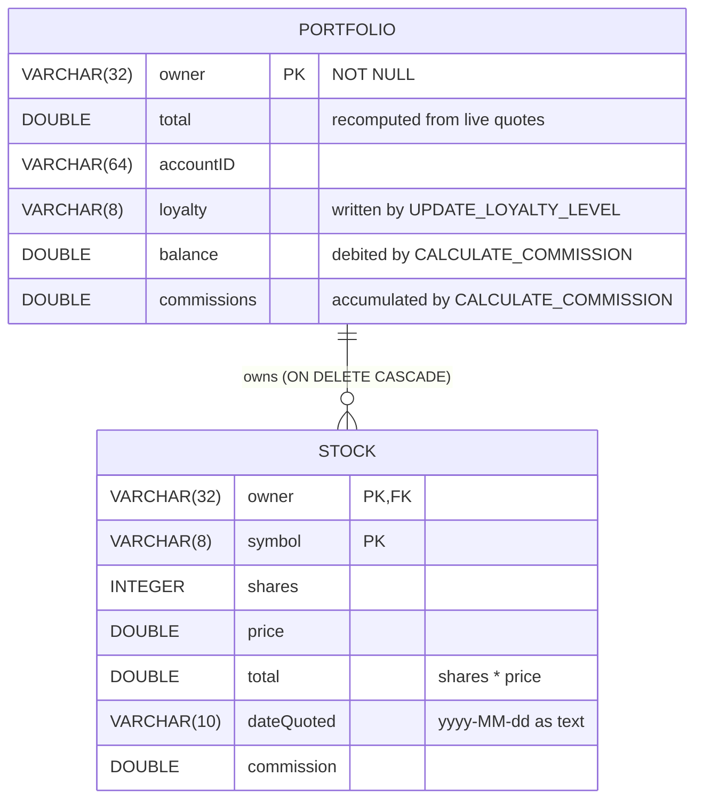

# DB2 Assessment — portfolio microservice

Phase 1 of the DB2 → PostgreSQL OLTP migration. This is the "as-was" picture: every DB2
object the `portfolio` service owns, and every place the Java code touches it.

## 1. Footprint at a glance

| Artifact | Location | DB2 specifics |
|---|---|---|
| `Portfolio` table | `createTables.ddl` | none beyond dialect defaults |
| `Stock` table | `createTables.ddl` | FK to `Portfolio` with `ON DELETE CASCADE`, implicitly indexed by DB2 |
| `UPDATE_LOYALTY_LEVEL` procedure | `stored-procs.ddl` | SQL PL (`LANGUAGE SQL`, `SPECIFIC`, `@` terminator) |
| `CALCULATE_COMMISSION` procedure | `stored-procs.ddl` | SQL PL with `IF/ELSEIF`, writes to `Portfolio` |
| Datasource | `src/main/liberty/config/includes/db2.xml` | `properties.db2.jcc`, `jcc-12.1.0.0.jar`, `securityMechanism="3"` |
| JDBC kind switch | `src/main/liberty/config/server.xml` | `JDBC_KIND` include, defaulted to `db2` |
| JDBC driver dependency | `pom.xml` | `com.ibm.db2:jcc:12.1.0.0` (`provided`) |
| Persistence unit | `src/main/resources/META-INF/persistence.xml` | JTA datasource `jdbc/Portfolio/PortfolioDB`, EclipseLink |
| Deployment secrets | `manifests/*.yaml`, `chart/portfolio/templates/deployment.yaml` | secret named `db2` supplies `JDBC_HOST/PORT/DB/ID/PASSWORD` |

Notably **all row access is JPA/EclipseLink**, not hand-written DB2 SQL: named queries
(`Portfolio.findAll`, `Stock.findByOwner`, `Stock.findByOwnerAndSymbol`), `em.find`,
`persist`, `merge`, `remove`. The only raw, dialect-bound SQL in the codebase is the two
`CallableStatement` procedure calls.

## 2. Schema inventory

### `Portfolio`

| Column | DB2 type | Null | Notes |
|---|---|---|---|
| `owner` | `VARCHAR(32)` | NOT NULL | primary key; the tenant/user identity |
| `total` | `DOUBLE PRECISION` | null | recomputed on every `GET /{owner}` from live quotes |
| `accountID` | `VARCHAR(64)` | null | id in the external Account/ODM system |
| `loyalty` | `VARCHAR(8)` | null | `Basic`/`Bronze`/`Silver`/`Gold`/`Platinum`, written by procedure |
| `balance` | `DOUBLE PRECISION` | null | cash balance, debited by commission procedure |
| `commissions` | `DOUBLE PRECISION` | null | running total of commissions charged |

### `Stock`

| Column | DB2 type | Null | Notes |
|---|---|---|---|
| `owner` | `VARCHAR(32)` | NOT NULL | PK part 1, FK → `Portfolio(owner)` `ON DELETE CASCADE` |
| `symbol` | `VARCHAR(8)` | NOT NULL | PK part 2 |
| `shares` | `INTEGER` | null | net position; the row is deleted when it reaches 0 |
| `price` | `DOUBLE PRECISION` | null | last quote seen |
| `total` | `DOUBLE PRECISION` | null | `shares * price` |
| `dateQuoted` | `VARCHAR(10)` | null | `yyyy-MM-dd` **stored as text**, mapped to `String date` |
| `commission` | `DOUBLE PRECISION` | null | accumulated commission for this position |

No sequences, identity columns, triggers, views, MQTs, or user-defined types. No `TIMESTAMP`,
`DECIMAL`, `CLOB`/`BLOB`, or `GRAPHIC` columns — which is why this migration is schema-cheap
and logic-expensive.

### ER diagram

## 3. Business logic inside the database

Both procedures are pure business policy that happens to be written in SQL PL. Neither uses
DB2-only capabilities — they are `CASE`/`IF` ladders plus an `UPDATE`.

### `UPDATE_LOYALTY_LEVEL(owner IN, total IN, loyalty OUT)`

Tiering, evaluated top-down, thresholds inclusive:

| Portfolio total | Loyalty level |
|---|---|
| `>= 1,000,000` | `Platinum` |
| `>= 100,000` | `Gold` |
| `>= 50,000` | `Silver` |
| `>= 10,000` | `Bronze` |
| otherwise | `Basic` |

Side effect: `UPDATE Portfolio SET loyalty = <level> WHERE owner = ?`, and the level is
returned to the caller.

### `CALCULATE_COMMISSION(owner IN, tradeValue IN, commission OUT)`

1. Reads the owner's `loyalty`, treating `NULL` as `Basic` (`COALESCE`).
2. Base commission by tier: `Platinum 5.99`, `Gold 6.99`, `Silver 7.99`, `Bronze 8.99`, `Basic 9.99`.
   The comparison is case sensitive, so any unexpected value falls through to `9.99`.
3. Block-trade surcharge: if `tradeValue > 250,000`, add `tradeValue * 0.00005` (half a basis point).
4. Side effects: `commissions = COALESCE(commissions,0) + commission` and
   `balance = COALESCE(balance,0) - commission`.
5. Returns the commission.

## 4. Where the Java code touches the database

| Call site | File | Mechanism | Migration impact |
|---|---|---|---|
| `getPortfolios` (paged) | `PortfolioService.java` | `Portfolio.findAll` named query + `setFirstResult/setMaxResults` | none — EclipseLink emits dialect-correct pagination |
| `createPortfolio` | `PortfolioService.java` → `PortfolioDao.createPortfolio` | `em.persist` | none |
| `getPortfolio` | `PortfolioService.java` → `StockDao.readStockByOwner`, `updateStock`, `PortfolioDao.updatePortfolio` | named query + `merge`/`flush` | none |
| loyalty refresh | `PortfolioService.invokeUpdateLoyaltyLevel` | **`CallableStatement` `CALL UPDATE_LOYALTY_LEVEL(?,?,?)`** on a raw datasource connection | **must change** — procedure does not exist on Postgres |
| commission on trade | `PortfolioService.invokeCalculateCommission` | **`CallableStatement` `CALL CALCULATE_COMMISSION(?,?,?)`** | **must change** |
| `updatePortfolio` (buy/sell) | `PortfolioService.java` → `StockDao` create/update/delete | JPA | none |
| `deletePortfolio` | `PortfolioService.java` → `PortfolioDao.deletePortfolio` | `em.remove` (FK cascade removes stocks) | none — but Postgres needs an explicit FK index |
| readiness probe | `PortfolioService.staticInitialize` | JNDI lookup of `jdbc/Portfolio/PortfolioDB` | none — JNDI name is unchanged |

## 5. Risk observations carried into Phase 2

1. **The procedures are the whole migration.** They hold the loyalty tiers and the commission
   schedule, including the surcharge rule; anything that re-implements them must match to the
   cent, and `balance`/`commissions` must move in lockstep with the returned commission.
2. **Two different connections, one logical unit of work.** The procedure calls run on a
   connection taken straight from the `DataSource`, outside the JPA persistence context that the
   surrounding `@Transactional` method uses; the in-memory entity therefore never saw the
   `balance`/`commissions` the procedure wrote. Moving the logic into the service layer removes
   this split-brain.
3. **`dateQuoted` is text, not a date.** Correct as-is on both engines, and out of scope to
   change; noted so nobody "fixes" it mid-migration and breaks the JSON contract.
4. **`double` money.** The schema stores money as floating point on both engines, so parity must
   be asserted with a tolerance rather than exact string equality (or with identical arithmetic
   order, which is what the lifted Java code gives us).
5. **Identifier case folding.** DB2 folds unquoted identifiers to upper case, PostgreSQL to lower
   case. Only relevant to hand-written SQL and CLI checks, not to EclipseLink.
6. **`securityMechanism="3"` and `sslMode`.** DB2 disables driver-side credential encryption for
   the mainframe; the Postgres datasource hard-coded `sslMode="verify-ca"`, which cannot work
   against a local container, so it needs to be configurable.
