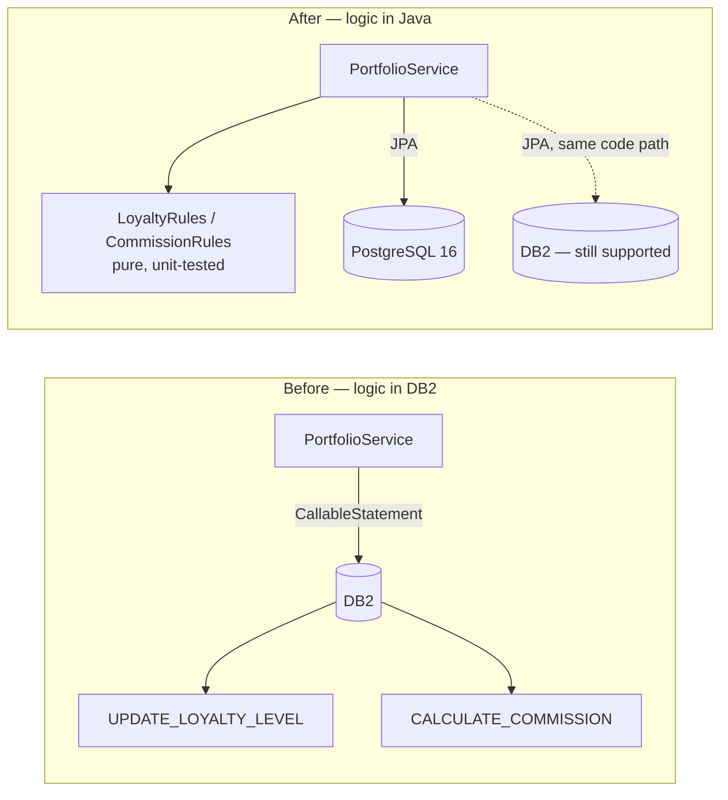

# DB2 → PostgreSQL Migration Plan — `portfolio` microservice

Companion to [`db2-assessment.md`](./db2-assessment.md). Goal: run the service on
PostgreSQL 16 with **no stored procedures**, while DB2 remains a supported backend from the
same codebase via the existing `JDBC_KIND` switch.

## 1. Strategy



Three decisions drive everything below:

1. **The schema is portable.** No identity columns, sequences, triggers, LOBs, or DB2 types
   beyond `VARCHAR`/`INTEGER`/`DOUBLE PRECISION`. One DDL file can target both engines.
2. **The procedures are not.** Their logic is lifted into plain Java classes, so the Postgres
   schema needs no procedures at all and the rules become unit-testable.
3. **DB2 stays runnable.** The lifted Java path is the default for *both* engines; the legacy
   `CallableStatement` path stays behind `USE_STORED_PROCS=true` so the old behaviour can be
   executed against DB2 and compared row-for-row (see §5).

## 2. Type mapping

| DB2 | PostgreSQL 16 | Rationale |
| --- | --- | --- |
| `VARCHAR(n)` | `VARCHAR(n)` | Identical semantics; length in characters in both |
| `INTEGER` | `INTEGER` | 4-byte signed in both |
| `DOUBLE PRECISION` / `DOUBLE` | `DOUBLE PRECISION` | IEEE-754 binary64 in both; `DOUBLE` (proc params) is DB2-only spelling |
| `SMALLINT` | `SMALLINT` | Not used by this schema |
| `TIMESTAMP` | `TIMESTAMP` | Not used — `dateQuoted` is `VARCHAR(10)` text |
| `GENERATED ALWAYS AS IDENTITY` | `GENERATED ALWAYS AS IDENTITY` | Not used — `owner` is a natural key |
| `CURRENT DATE` / `CURRENT TIMESTAMP` | `CURRENT_DATE` / `CURRENT_TIMESTAMP` | Not used; listed for future columns |
| `VALUES(...)` / `SYSIBM.SYSDUMMY1` | `SELECT ...` | Not used |
| `FETCH FIRST n ROWS ONLY` | `LIMIT n` (also accepts `FETCH FIRST`) | Emitted by EclipseLink, not hand-written |
| `LANGUAGE SQL` procedure (SQL PL) | *(removed — lifted to Java)* | See §4 |
| `CallableStatement` `CALL p(?,?,?)` | *(removed — Java method call)* | See §4 |

Identifier folding: DB2 upper-cases unquoted identifiers, Postgres lower-cases them. Both
DDL and JPA mappings stay unquoted, so each engine is self-consistent; only ad-hoc CLI SQL
must respect the difference.

## 3. File-by-file plan

| File | Change |
| --- | --- |
| `createTables.ddl` | Add `IF NOT EXISTS`, explicit `CONSTRAINT` names, and cross-engine-safe formatting; keep types unchanged (they are already portable). Runnable via `db2 -tf` **and** `psql -f`. |
| `stored-procs.ddl` | Kept for the DB2 backend and for parity testing only; header updated to state it is legacy and **not** required on Postgres. |
| `src/main/java/.../rules/LoyaltyRules.java` | **New.** Pure `loyaltyFor(double total)` implementing the tier table. |
| `src/main/java/.../rules/CommissionRules.java` | **New.** Pure `baseCommissionFor(String loyalty)` + `commissionFor(String loyalty, double tradeValue)` implementing the tiered schedule and block-trade surcharge. |
| `src/main/java/.../PortfolioService.java` | `invokeUpdateLoyaltyLevel` / `invokeCalculateCommission` become dispatchers: Java rules by default (persisting via JPA), legacy `CallableStatement` only when `USE_STORED_PROCS=true`. Loyalty is read *before* recomputation to preserve proc ordering (assessment §3.3). |
| `src/test/java/.../rules/LoyaltyRulesTest.java`, `CommissionRulesTest.java` | **New.** JUnit tests covering every tier, tier boundaries, the surcharge threshold, and null/negative inputs. |
| `src/main/liberty/config/includes/postgres.xml` | Parameterise TLS via `JDBC_SSL_MODE` (default `verify-ca`, set to `disable` locally) so the same include works in-cluster and against a local container. |
| `src/main/liberty/config/includes/db2.xml` | Unchanged — DB2 remains selectable with `JDBC_KIND=db2`. |
| `pom.xml` | Postgres driver already present as `provided`; no dependency change needed. |
| `docker/` | **New.** `docker-compose.yml` (`ibmcom/db2` + `postgres:16`), seed data, and load scripts for both engines. |
| `tools/parity-dashboard/` | **New.** Side-by-side parity harness/UI (see §5). |
| `docs/` | This plan plus the assessment. |
| `README.md` | Document `JDBC_KIND`, `USE_STORED_PROCS`, and the Postgres quickstart. |

## 4. Lifting the procedures into Java

```
UPDATE_LOYALTY_LEVEL(owner, total) -> loyalty
    becomes  LoyaltyRules.loyaltyFor(total)                       // pure
             + portfolio.setLoyalty(...) persisted by the existing JPA merge

CALCULATE_COMMISSION(owner, tradeValue) -> commission
    becomes  CommissionRules.commissionFor(loyaltyAtTradeStart, tradeValue)   // pure
             + portfolio.setCommissions(old + c); portfolio.setBalance(old - c)
```

Equivalence requirements carried over from the SQL PL bodies:

- inclusive lower bounds on the tier thresholds (`>=`), evaluated highest-first;
- `NULL` loyalty behaves as `Basic`, `NULL` balance/commissions as `0` (`COALESCE`);
- surcharge applies strictly above `250000.0` and is added to, not multiplied with, the base;
- the returned commission is what gets written onto the `Stock` row, and the same value is
  debited from `balance` and credited to `commissions` — one write, no double-counting.

Side benefit: the extra `datasource.getConnection()` per trade disappears, and the loyalty /
commission writes now happen inside the persistence context instead of behind its back.

## 5. Verification approach

| Stage | What it proves |
| --- | --- |
| Unit tests on the rules classes | The lifted arithmetic matches the SQL PL tier tables |
| `docker/docker-compose.yml` — `ibmcom/db2` + `postgres:16`, identical seed data | Both engines start from byte-identical state |
| Legacy path (`USE_STORED_PROCS=true`) against DB2, new path against Postgres, same scenario | End-to-end behavioural parity, not just arithmetic parity |
| Parity dashboard: create → buy across loyalty tiers → fetch → sell → delete, with MATCH/MISMATCH badges per step and a final row-level reconciliation table | Human-verifiable, per-step evidence including the tier-crossing cases |
| Negative control: tamper one Postgres row and re-run the reconciliation | The dashboard's green badges are trustworthy because it can go red |
| `db2` CLI and `psql` transcripts of the final rows | The UI is reporting what is actually in the tables |

## 6. Rollout / rollback

1. Deploy with `JDBC_KIND=db2` and `USE_STORED_PROCS=false` — the Java rules take over while
   still on DB2, isolating the code change from the engine change.
2. Load the Postgres schema, migrate data (`Portfolio` then `Stock`; two tables, natural keys,
   no sequences to reset), and cut over with `JDBC_KIND=postgres`.
3. Rollback is `JDBC_KIND=db2` (and `USE_STORED_PROCS=true` if the procs must own the rules
   again); no schema change is required on the DB2 side, so both engines stay warm during the
   cutover window.
4. Once Postgres is the only backend, drop `stored-procs.ddl`, the DB2 driver dependency, and
   the `db2.xml` include.
